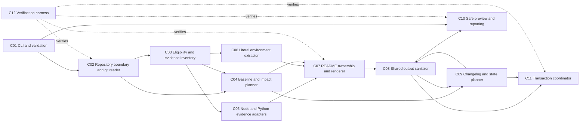
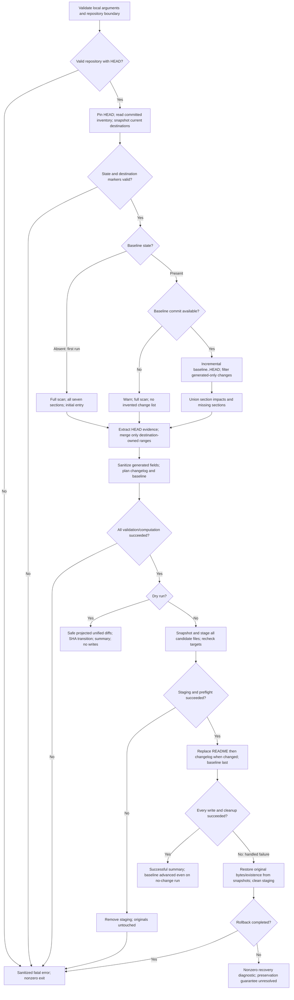

# Architecture: doc-sync-agent

## 1. Overview

This design covers the local-repository portions of docs/requirements.md, with Node.js/TypeScript and Python stack adapters and deterministic, evidence-based documentation generation. Committed HEAD content supplies all extraction evidence, while current destination files supply only preservation and merge content. A validated change plan supports incremental synchronization, secret-safe dry-run previews, and recoverable writes with the baseline installed last. GitHub acquisition, URL output handling, branch selection, network retries, and Java/Maven/Go stack adapters are deferred without changing the source requirements.

## 2. Technology Choices

These are design choices, not installed dependencies or claims of implementation.

| Technology | One-line reason | Requirements |
| --- | --- | --- |
| Strict TypeScript, Node.js ESM, Node.js 20+ | Required implementation and cross-platform runtime contract. | NFR-3, NFR-7 |
| commander | Required CLI parser for local path and `--dry-run`, with unsupported options rejected before work. | FR-1, FR-2, FR-20, NFR-7 |
| zod | Required validation of CLI inputs, normalized paths, persisted state, and external parsed data before consumption. | FR-2, FR-14, NFR-7 |
| simple-git with argument arrays | Required git interface for immutable HEAD trees, status, baseline availability, and committed diffs without shell interpolation. | FR-5, FR-13, FR-15, FR-16, NFR-7 |
| Native JSON parser and smol-toml | Established parsers for package/state JSON and Python TOML avoid hand-written structured-data parsing. | FR-2, FR-6, FR-7, FR-8 |
| unified with remark-parse, remark-gfm and unist source offsets | Markdown ASTs distinguish tables from prose and identify manual headings, usage sections and markers without reserializing preserved bytes. | FR-7, FR-8, FR-10, FR-11, FR-12 |
| ignore | Established gitignore pattern parsing supports committed nested rules; integration tests must establish Git-compatible precedence and directory behavior. | FR-5, NFR-2 |
| diff | Established unified-diff rendering operates on safe generated-only projections, never raw manual destinations. | FR-20, FR-25 |
| Node.js fs/path/crypto and monotonic performance clock | Standard primitives support containment checks, byte snapshots, staged writes, hashes, and reproducible timing. | FR-5, FR-22, NFR-1, NFR-3 |
| Vitest and its coverage tooling | Required tests and four independent 80% coverage thresholds, with injected filesystem faults and UTC clocks. | NFR-4, NFR-6, NFR-7 |

No repository dependencies, scripts, setup commands, or extracted usage commands are executed. Environment references use bounded literal token recognition, not runtime evaluation; `.env.example` uses the explicitly limited assignment grammar, not dotenv evaluation.

## 3. Component Diagram



The sanitizer is a single shared policy invoked at every emission boundary, not a second extraction source. The planner/sanitizer arrows represent validation of candidate fields and final emitted artifacts, not an iterative generation loop.

## 4. Components and Responsibilities

| Component | Responsibility | Inputs | Outputs | Requirements covered |
| --- | --- | --- | --- | --- |
| C01 CLI and validation | Accept local input, reject URL-only options and unsupported remote inputs, validate external values and classify errors. | Arguments, local path, parsed state | Valid local request or sanitized nonzero diagnostic | FR-1, FR-2, FR-4, FR-20, FR-21, FR-25, NFR-3, NFR-7 |
| C02 Repository boundary and git reader | Resolve the root, pin HEAD, check history/status, read tracked committed blobs and diffs without traversing links. | Valid request, git metadata, baseline SHA | HEAD snapshot, dirty warning, status, committed trees/deltas | FR-5, FR-13, FR-15, FR-16, FR-21, FR-24, NFR-3, NFR-7 |
| C03 Eligibility and evidence inventory | Apply committed ignore rules, file security policy, deterministic manifest ordering and eligible counts. | HEAD tree and blobs, baseline tree when available | Ordered safe evidence inventory and filtered changes | FR-5, FR-6, FR-13, FR-24, NFR-1, NFR-2, NFR-5 |
| C04 Baseline and impact planner | Classify initial/fallback/incremental runs and calculate the union of section impacts, including rename endpoints. | Valid state, available commits, filtered changes, missing markers | Mode, impacted names, relevant changed paths | FR-12, FR-13, FR-14, FR-15, FR-16, FR-17, FR-18 |
| C05 Node and Python evidence adapters | Extract approved manifest fields/setup/usage and committed manual README fallbacks only. | Ordered manifests, committed manual README AST | Evidence-backed name, purpose, stacks, setup, usage or `Not Found` | FR-6, FR-7, FR-8, FR-9, FR-10, FR-15, NFR-5 |
| C06 Literal environment extractor | Collect assignment names and all specified literal reference forms without evaluating expressions or retaining values. | Eligible source/configuration, streamed `.env.example` lines | Sorted unique valid names or `Not Found` | FR-7, FR-13, FR-24, FR-25, NFR-5 |
| C07 README ownership and renderer | Validate markers, calculate owned byte ranges, update impacted/missing sections and preserve all other bytes. | Safe evidence, current destination snapshot, section impact plan | Candidate README, generated-section updates and ownership ranges | FR-7, FR-11, FR-12, FR-13, FR-15, FR-17, FR-19, NFR-5 |
| C08 Shared output sanitizer | Apply the same deterministic redaction and conservative extraction policy to every emitted field and safe diagnostic. | Candidate evidence, generated fields, paths, safe error categories | Sanitized values or `Not Found`; no raw errors/manual previews | FR-10, FR-18, FR-20, FR-24, FR-25, NFR-5 |
| C09 Changelog and state planner | Decide append/no-entry, preserve prior changelog bytes, format UTC metadata and plan the new baseline. | Section updates, relevant paths, current changelog/state, injected clock | Complete candidate changelog/state and baseline transition | FR-14, FR-16, FR-18, FR-19, FR-22, FR-25, NFR-5 |
| C10 Safe preview and reporting | Emit generated-only unified previews, baseline transition, warnings and per-section results without persistence. | Sanitized plan, generated-only projections, safe statuses | Dry-run preview and normal summaries or nonzero error | FR-17, FR-18, FR-20, FR-21, FR-25 |
| C11 Transaction coordinator | Snapshot, stage, revalidate, replace data outputs, install baseline last and roll back handled write failures. | Validated complete plan, original bytes/existence, safe target paths | Successful output set or restored original set; explicit rollback-failure diagnostic | FR-2, FR-5, FR-12, FR-14, FR-19, FR-20, FR-21, FR-22, NFR-3, NFR-6 |
| C12 Verification harness | Test success/failure paths, secret safety, rollback faults, determinism, timing, coverage and OS/runtime compatibility. | Synthetic fixtures, disposable sample copy, injected filesystem/clock | Acceptance evidence, timing records, coverage and test results | NFR-1, NFR-2, NFR-3, NFR-4, NFR-5, NFR-6, NFR-7 |

## 5. Data Flow



All pre-write error edges leave destinations unchanged. Dry runs use the same validated plan but never enter staging; validation errors in dry runs remain fatal and do not produce partial output files. No acquisition, fetch, retry, or branch-selection path exists in this scope.

## 6. Data and State

### Evidence and Destination Boundaries

Pin a single HEAD SHA for the run and obtain tracked paths, modes, committed ignore files, manifests, sources and README blobs from that commit. Do not read working-tree source files as evidence, including dirty manifests or ignore files. Warn when the working tree is dirty; staged, unstaged and untracked source changes are ignored. Current root README/changelog/state are read only as destination preservation/state inputs, never to fill an evidence gap.

Inventory excludes `.git`, `node_modules`, `dist`, symlinks, out-of-root paths, prohibited secret files, and `.docsync.json`/`CHANGELOG.md` in every directory. Apply HEAD's committed nested `.gitignore` rules even to tracked files; use repository-relative `/` paths and deterministic ordering. Include an eligible README's manual portion as evidence: strip generated blocks for semantic README comparison and fallback extraction, rather than excluding every README. A README with only generated-block changes does not cause a relevant change or Project Structure update; a real manual README change must remain visible. Generated-only READMEs with no manual evidence are excluded from source-change counting; precise file-count treatment of mixed READMEs is flagged in Section 10.

For baseline comparisons, evaluate both old and new eligible paths and their respective committed contents/rules, using HEAD rules for the current inventory. Exclude state/changelog changes and remove README generated blocks before deciding whether an addition/deletion/rename is relevant. Retain the manual portions of renamed/deleted READMEs for this comparison. An unavailable baseline supplies no fabricated changed paths.

Root manifests precede nested manifests; nested directory paths sort ascending with `/` separators. Within a directory, supported priority is `package.json`, `pyproject.toml`, then `requirements.txt`, retaining the relative order specified by FR-8 after deferred adapters are removed. Name selection checks package `name`, Python `[project].name`, then `[tool.poetry].name`; purpose checks package `description`, then Python `[project].description` and `[tool.poetry].description`. Use first nonempty supported fields. Committed README fallback is its first manual H1 for name, first manual prose paragraph for purpose, and first case-insensitive ATX `Usage` section through the next equal/higher-level heading for usage. Skip headings, lists, tables, comments, fenced code and image/badge-only paragraphs for purpose; join paragraph lines with spaces.

Detect every supported Node/Python stack, never infer unsupported ones. Setup is `npm install` or `pip install -r requirements.txt`, deduplicated by directory and command in scan order; pyproject-only setup is `Not Found`. Usage lists `npm run <script>` from script keys and declared executable/bin names with directories, never script bodies; only if no manifest usage exists does the committed manual Usage fallback apply. Project Structure is sorted eligible file paths. Sanitize all emitted evidence; absent or unsafe evidence is `Not Found`.

### State Schema

The following is a declarative JSON Schema for the chosen local state representation, not implementation code. The field name is a design choice for FR-14; no timestamp, credentials, repository URL, or branch is stored in this local-only schema.

```json
{
  "$schema": "https://json-schema.org/draft/2020-12/schema",
  "title": "Local doc-sync baseline state",
  "type": "object",
  "additionalProperties": false,
  "required": ["lastSyncedSha"],
  "properties": {
    "lastSyncedSha": {
      "type": "string",
      "pattern": "^(?:[0-9a-f]{40}|[0-9a-f]{64})$"
    }
  }
}
```

Read `.docsync.json` directly at the local repository root and validate with zod before using its SHA in git operations. SHA syntax validation is separate from checking that the object is an available commit in the current repository. Absent state means initial full scan; malformed state is fatal; syntactically valid but unavailable history means warning and full scan without fetch/deepening. Accept SHA length consistent with the repository object format. On successful normal runs store the pinned HEAD, including when no relevant change exists; dry runs and failures do not advance it. URL identity/branch fields are deferred, not silently accepted as a completed remote-state contract.

### README Ownership

| Section heading | Exact start marker | Exact end marker |
| --- | --- | --- |
| Project Name | `<!-- docsync:start project-name -->` | `<!-- docsync:end project-name -->` |
| Purpose | `<!-- docsync:start purpose -->` | `<!-- docsync:end purpose -->` |
| Tech Stack | `<!-- docsync:start tech-stack -->` | `<!-- docsync:end tech-stack -->` |
| Setup/Install Steps | `<!-- docsync:start setup -->` | `<!-- docsync:end setup -->` |
| Usage | `<!-- docsync:start usage -->` | `<!-- docsync:end usage -->` |
| Project Structure | `<!-- docsync:start project-structure -->` | `<!-- docsync:end project-structure -->` |
| Environment Variables | `<!-- docsync:start environment-variables -->` | `<!-- docsync:end environment-variables -->` |

Each pair encloses its corresponding generated heading and body. Reject unknown, duplicate, nested, unmatched, end-before-start, or crossed pairs before writing. Existing complete pairs may occur in any section order: FR-11's out-of-order prohibition concerns pair correctness, not a canonical ordering requirement for existing sections. Do not reorder existing pairs. Validate committed README markers used for extraction as well as destination markers used for merging; strip only validated ownership ranges.

Preserve all manual bytes outside markers, existing line endings and unaffected generated sections. Splice byte ranges, not a full Markdown reserialization. New README files use LF; added blocks in existing files use the existing line-ending convention. For mixed line endings, preserve existing bytes and flag appended-block convention as an open question. Preserve an existing final manual byte even when it lacks a newline; append the separator as new bytes. Append missing sections in canonical table order even without source changes or when an unmarked equivalent manual heading exists.

With a valid baseline, a supported manifest change affects `project-name`, `purpose`, `tech-stack`, `setup`, `usage`, and `environment-variables`; manual README changes affect `project-name`, `purpose`, and `usage`; other source/configuration and `.env.example` changes affect `environment-variables`. Any eligible addition/deletion/rename also affects `project-structure`. Take the union across changes and both rename paths; missing sections are always added. Full scans recompute all sections without replacing manual content.

### CHANGELOG Format and Decisions

Append new entries after existing changelog bytes; do not rewrite previous entries. Use this documented entry shape, where angle-bracket fields denote sanitized values, not literal project facts:

```text
## <YYYY-MM-DD> - <Initial documentation sync | Documentation sync>

Changed paths:
- <sanitized repository-relative path, or Not Found>

Documentation updates:
- <canonical section name>: <added | changed | Not Found>
```

Use the UTC calendar date from an injected clock. Initial successful sync always appends `Initial documentation sync`. Later runs append one entry for relevant committed changes or generated README updates, even when both occur together; otherwise report `No changes detected` without an entry. A missing-history fallback appends only if generated output changes and uses `Not Found` for unavailable changed paths; missing history alone is not a change. Missing sections can therefore produce an entry without committed source changes. The state transition alone is not an entry trigger. A missing changelog is created only when an entry is needed; dry-run treats missing outputs as empty.

## 7. Error Handling Strategy

Invalid/missing paths, non-git directories, empty repositories with no HEAD, malformed state, malformed markers, prohibited output links, required unreadable inputs and unsafe output collisions are fatal with stable sanitized categories and a nonzero status. Optional evidence absence produces `Not Found`. A missing recorded commit is specifically a warning/full-scan case, not a fatal error. Remote HTTP/network categories are deferred rather than simulated. Suppress raw git stderr, raw exception messages, source snippets and sensitive paths from diagnostics.

### Cross-file Write Protocol

1. Finish extraction, marker/state validation, sanitization, summary construction and the complete three-file plan before any output write. Capture each destination's existence, bytes and relevant identity/permissions; refuse non-regular files, symlinks/reparse points, unsafe ancestors and collisions. Keep restorable originals, including absence, until success is certain.
2. In a normal run only, stage candidate files and byte-exact rollback snapshots under unique private names on the destination filesystem, with restrictive permissions where supported. Do not stage anything on dry runs. Verify staged bytes and successful close/flush operations before replacing a target. If snapshot/staging fails, remove temporary artifacts and leave originals untouched.
3. Immediately before replacement, recheck containment, ancestor/target types, identity and original bytes. If a target differs from the snapshot, abort before replacement rather than overwriting a detected manual edit. Write only changed data files: replace README first, then changelog, using same-filesystem replacement primitives verified on Windows/macOS/Linux. Never delete an original merely to make a rename succeed.
4. Install `.docsync.json` last, only after data-output replacements have succeeded. Even a no-change run must advance a changed baseline. Retain snapshots through state installation and cleanup; perform no remaining fallible work after releasing the recovery material. Prepare reporting before commit and do not classify a later console-pipe failure as a reversible file transaction failure.
5. On a handled staging/replacement/state/cleanup error, restore replaced destinations in reverse order, restoring original bytes/existence and preserved metadata; remove files originally absent. Restore the original baseline too if it was replaced. Remove staged candidates and rollback artifacts, verify restored bytes/existence against snapshots, return a sanitized nonzero error, and never report a successful sync.

Guarantee: for handled failures within this protocol, provided rollback operations succeed, targets end byte-for-byte unchanged and newly generated targets are absent. Baseline-last prevents declaring a completed sync before its documentation writes succeed. Recoverable errors must also remove temporary artifacts; snapshot-release ordering and cleanup failures require fault tests, not optimistic assertions. Use held original bytes as a fallback until cleanup completes so a handled cleanup error can still restore files after on-disk snapshots were removed.

This is not a filesystem-wide atomic transaction. Readers may see intermediate file versions; power loss, forced process termination, rollback failure, or concurrent edits after revalidation can break preservation or consistency. File flushes and same-filesystem replacement reduce some risks but do not solve cross-file atomicity or all TOCTOU races. Report rollback failure distinctly without exposing recovery contents, and do not pretend FR-22 is unconditionally fulfilled under these unresolved constraints. No unrequested persistent journal/recovery feature is assumed.

### Verification Strategy

C12 must create a disposable copy of `samples/bookmark-api` outside the original sample tree and initialize an independent local git history there as needed; all write-mode checks and fixture commits target that copy only. Record commands, exit codes and sanitized outcomes during future implementation verification. Never run the tool or mutating tests against the original sample. This architecture task does not execute those tests or implementation workflows.

Use focused Vitest cases for every new function's happy path and failure/`Not Found` path, then integration cases for initial and incremental sync, no-op baseline advance, missing/unavailable/malformed state, dirty-source isolation, Node/Python nested ordering, all fallbacks, missing sections, manual byte preservation and valid/invalid marker permutations. Commit generated-only README/state/changelog changes and assert no entry or Project Structure impact; then commit manual README evidence and assert the name/purpose/usage impact survives filtering. Cover rename endpoints, committed nested ignore rules versus dirty ignores, tracked-but-ignored files, above-500 warnings without truncation, absent files, symlinks and unsafe output collisions.

Fault injection must fail each candidate/snapshot open, write, close/flush, target replacement (README, changelog, baseline), preflight recheck, and temporary cleanup independently, including failure immediately after a successful replacement. Compare pre/post hashes, bytes and existence of all three targets and assert original state restored, no new targets/temporary artifacts, no success report and nonzero status for handled recoverable failures. Repeat with originally absent outputs and a no-change baseline-only write. Separately inject rollback failure and concurrent replacement to verify an explicit unresolved-recovery diagnostic rather than a false atomicity claim.

Dry-run tests compare recursive file lists/hashes before/after, including absent outputs, and capture console output with synthetic secrets in both manual README/changelog context and generated candidates. Assert no manual context or environment values appear, no baseline writes occur, safe unified diffs and SHA transition appear, and all FR-25 patterns plus every FR-24 literal syntax are covered. Inject UTC dates; verify deterministic repeated rendering. Require at least 80% each for lines, branches, functions and statements and run the Windows/macOS/Linux by Node.js 20/22/24 latest-patch matrix. These are future verification gates, not results from writing this document.

For NFR-1, retain a deterministic local 500-eligible-file fixture with files at most 16 KiB, all four stacks represented, 50 committed changed files and three monotonic timings, each under 30 seconds, on Linux x64, 4 logical CPUs, 8 GiB RAM, SSD and Node.js 24. Time scanning/diffing/sanitization/generation only, excluding writes/cleanup and acquisition. Keep Maven and Go manifests/source files in the fixture as eligible generic evidence, without adding deferred stack detection or setup adapters. The full stated performance gate remains in scope: fixture composition does not require those adapters. No fixed latency is promised for arbitrarily large individual files.

## 8. Security Design

Validate external input with zod before use and pass git argument arrays without shell expansion. Resolve paths to the actual local root, enforce containment and inspect every output directory component and target with link-aware filesystem checks; reject symlinks and Windows reparse-point/junction escapes rather than following them. Git tree modes exclude source symlinks and submodule entries are not traversed. Never read evidence outside the pinned repository tree. Reject URL input in this scope with a constant diagnostic; never echo credential-bearing input.

Never open `.env` or `.env.*` except the exact basename `.env.example`; exclude `.pem`, `.key`, and `.p12` private-key files before content access. Parse only the valid assignment left-hand name, with optional `export`, from `.env.example`; discard values immediately, never store parsed assignments. Literal recognition covers `process.env.X`, `process.env["X"]`, `os.environ["X"]`, `os.environ.get("X")`, `os.getenv("X")`, `System.getenv("X")`, `os.Getenv("X")`, and `os.LookupEnv("X")`, accepting either quote style where applicable. These are generic lexical forms even in Java/Go files, not Java/Go stack adapters, and remain in scope. Do not evaluate dynamic expressions; emit unique names matching `[A-Za-z_][A-Za-z0-9_]*` in ascending order or `Not Found`.

C08 applies one deterministic policy to every emitted evidence field, filename/path, command name, changelog update, preview, summary, warning and error: redact PEM private-key blocks, URL user-info, bearer credentials, tokens with `ghp_`, `github_pat_`, `gho_`, `ghu_`, `ghs_`, `ghr_`, AWS IDs with `AKIA`/`ASIA`, and values assigned to case-insensitive keys containing `secret`, `token`, `password`, `passwd`, `api_key` or `apikey`. Replace matches with `[REDACTED]`; also redact assigned values in environment-reference expressions. Sanitize names before embedding them in approved commands. Unsafe candidates become `Not Found`; raw source, manifest script bodies, environment assignments, parser excerpts and exception messages are never emission inputs.

Existing manual README and changelog bytes are preserved even when sensitive; sanitizer application must not rewrite them. Dry-run builds separate safe old/new projections containing only tool-owned generated sections or newly appended changelog entry text. Re-sanitize old generated text, use zero-context unified diffs, sanitized headers, and no existing manual changelog entries, manual README lines, adjacent context or raw destination diffs. Label these as generated-only projections with projection-relative hunk coordinates: they are previews, not full-file apply-ready patches. Print the sanitized baseline SHA transition separately. No persistent artifacts are created to render a preview. Pattern matching cannot certify that arbitrary unlabeled secrets are absent; conservative extraction and no raw-content output reduce but do not eliminate that limitation.

## 9. Traceability Matrix

"In scope" below means designed here, not implemented or verified. Deferred behavior has no implementing component in this design; local rejection of unsupported inputs is distinct from implementing their remote behavior.

| Requirement | In-scope behavior and component references | Deferred portion |
| --- | --- | --- |
| FR-1 | C01 accepts validated local repository paths and rejects unsupported URL inputs safely. | Public GitHub URL operation and remote private/public classification. |
| FR-2 | C01, C11 validate local paths, options, state and collisions before writes; nonzero safe failure. | Validation of accepted remote URL inputs is deferred with URL operation. |
| FR-3 | No acquisition component; C01 rejects remote input. | Entire full-clone/default-branch/selected-branch/temporary-clone-cleanup requirement. |
| FR-4 | C01 rejects `--out` and `--branch` for local input. | URL output directory creation/collision/identity checks, seeding, reuse and remote output layout. |
| FR-5 | C02, C03, C11 inspect committed tracked evidence, ordered manifests, exclusions and safe output boundaries. | No generic scanning/security deferral; deferred adapters do not remove generic eligible files. |
| FR-6 | C03, C05 detect all supported Node/Python stacks and report unsupported evidence as `Not Found`. | Java/Maven and Go stack detection. |
| FR-7 | C05, C06, C07 render all seven sections with approved evidence, sorted structure and name fallback. | Maven/Go-specific name extraction and stack-derived facts. |
| FR-8 | C05 preserves root/nested and supported field precedence plus committed manual prose fallback. | Maven description and Java/Go manifest positions when their adapters are absent. |
| FR-9 | C05 generates approved Node/requirements commands with directory deduplication; pyproject-only `Not Found`. | `mvn install` and `go build` mappings. |
| FR-10 | C05, C08 handle script keys/bin names and committed Usage fallback without bodies, sanitized. | None. |
| FR-11 | C07 validates exact canonical pairs and rejects malformed ownership. | None. |
| FR-12 | C04, C07, C11 preserve manual bytes/endings and append missing sections on every applicable run. | None; mixed-ending append convention needs clarification. |
| FR-13 | C02, C03, C04, C07 union impacts, handle renames and filter generated-only changes without discarding manual README evidence. | Java/Go manifest-specific impacts follow deferred adapter support; generic source/configuration/path impacts remain. |
| FR-14 | C04, C09, C11 store local successful HEAD baseline last, including no-change runs. | URL/branch identity state and `--out` baseline placement. |
| FR-15 | C02, C05, C07 use baseline..HEAD and committed evidence, warn on dirty source, preserve current destinations. | None. |
| FR-16 | C02, C04, C09 use initial/missing-history full scans, warn without fetch, distinguish malformed state. | Full-clone context only; local fallback remains fully in scope. |
| FR-17 | C04, C07, C10 report changed paths/impacts and added/changed/`Not Found` section results. | None. |
| FR-18 | C04, C08, C09, C10 append dated initial/relevant-update entries, preserve prior entries, suppress no-op entries. | None. |
| FR-19 | C07, C09, C11 write the validated local plan directly by default. | None. |
| FR-20 | C08, C10, C11 preview safe projected unified diffs, baseline transition and summaries with no writes. | Remote clone/cleanup and absent `--out` semantics. |
| FR-21 | C01, C02, C10, C11 provide safe explicit local fatal errors and optional-evidence `Not Found`. | GitHub 404/network failure handling. |
| FR-22 | C09, C11 stage/snapshot/rollback handled errors and preserve output bytes/existence when recovery succeeds. | Not a scope deferral: unconditional atomicity remains an unresolved constraint under termination, power loss, rollback failure or concurrency. |
| FR-23 | No network/retry component. | Entire retry/backoff, rate-limit and permanent-HTTP-error behavior. |
| FR-24 | C02, C03, C06, C08 skip prohibited files and extract assignment names plus every specified literal syntax generically. | No literal-form deferral; Java/Go forms stay in scope without stack detection. |
| FR-25 | C01, C06, C08, C09, C10 apply shared redaction, safe diagnostics and manual-free previews. | Operational validation of accepted credential-bearing remote URLs; local URL rejection never echoes input. |
| NFR-1 | C03, C12 design the timing boundary, scale warning and full four-stack, 500-file/50-change/three-run benchmark; Java/Go files remain generic evidence. | None; performance verification remains required despite adapter deferrals. |
| NFR-2 | C03, C12 count all eligible tracked files, apply committed ignores and exclusions, warn above 500 without truncation. | None; mixed README counting interpretation is open. |
| NFR-3 | C01, C02, C11, C12 target Node.js 20+ and the three-OS by Node.js 20/22/24 latest-patch matrix. | None. |
| NFR-4 | C12 requires each coverage metric at least 80% and success/failure tests per new function. | None; unexecuted until implementation exists. |
| NFR-5 | C03, C05, C06, C07, C08, C09, C12 enforce ordered evidence/templates and no AI; UTC dates are metadata. | None. |
| NFR-6 | C11, C12 test local validation/collisions, committed-only scans, preservation/markers/impacts, dry runs, fallback, dates, all secret/env forms, symlinks and write failures. | Full-clone URL runs, remote identity/cleanup and retry/rate-limit tests; adapter-specific Java/Go cases. |
| NFR-7 | C01, C02, C12 and the shared runtime use strict TypeScript, ESM, commander, simple-git, zod and Vitest. | None. |

## 10. Risks and Open Questions

- FR-22 is stronger than portable multi-file filesystem guarantees. Staging and rollback satisfy handled recoverable errors, not unconditional atomic visibility or recovery after power loss/forced termination/rollback failure; acceptance must acknowledge this constraint rather than declare it solved. Concurrent edits and symlink swaps between checking and replacing remain TOCTOU risks with portable Node.js filesystem APIs (FR-5, FR-12, FR-22).
- FR-11 says both "out-of-order" pairs are invalid and valid pairs may appear in any section order. This design interprets that as end-before-start/crossed pairing, not canonical section ordering; confirm that interpretation and whether marker-like comments inside fenced code are literal content or malformed ownership (FR-11).
- FR-12 does not select the newline convention for appended blocks in mixed-ending READMEs; no existing bytes may be normalized. Malformed committed markers versus valid current destination markers also need an explicit acceptance decision; this design fails rather than guessing ownership (FR-11, FR-12, FR-15).
- FR-13/NFR-2 do not define exactly how to count a mixed manual/generated README as a file or detect manual-content-bearing README renames whose identity changes. Preserve manual evidence, ignore generated-only deltas, and test the agreed semantic comparison before claiming exact file-count conformance (FR-5, FR-13, NFR-2).
- FR-20 unified diffs conflict with showing manual context forbidden by FR-25. Generated-only zero-context projections are the security-preserving design; confirm projection-relative hunk coordinates are accepted rather than full-file, apply-ready patches (FR-20, FR-25).
- FR-25's ban on every secret is not provable with finite patterns for arbitrary unlabeled strings. Never echo raw content and report unsafe extraction as `Not Found`; preserved manual files may still contain secrets and the tool is not a secret-free certification (FR-25).
- Malformed supported manifests, binary/non-UTF-8 eligible files, and unreadable optional evidence need precise classification tests; requirements distinguish missing optional evidence from required unreadable/invalid inputs but do not specify every case. Do not invent project facts to compensate. Verify remark-gfm table recognition so table cells cannot become the Purpose fallback (FR-2, FR-7, FR-8, FR-21).
- Committed nested ignore semantics, filename encoding/case behavior and atomic replacement support differ across platforms. Confirm parser parity against Git and byte-preserving replacement behavior on the required OS matrix; no dependency choice alone proves conformance (FR-5, FR-22, NFR-2, NFR-3).
- NFR-1's acceptance fixture explicitly requires four stacks while the active scope permits only two adapters. Keep all four stacks' files in the fixture and retain the exact hardware/runtime/file-count/timing gate; generic scanning of Java/Go evidence does not authorize their deferred detection/setup adapters. Do not substitute a two-stack fixture for acceptance (NFR-1).

## 11. Known Limitations

These deferrals belong to this timeboxed architecture only; docs/requirements.md remains unchanged. No requirement ID is renumbered, removed, or represented as implemented by this document.

| Requirement IDs | Deferred or limited portion | Still in scope |
| --- | --- | --- |
| FR-1, FR-2, FR-3, FR-21, FR-25 | GitHub URL acceptance/validation and private/public classification, cloning, branch resolution, remote availability/auth/network diagnostics and temporary clone lifecycle. | Local input validation/rejection, no credential echo, local availability errors and secret protection. |
| FR-3, FR-4, FR-14, FR-20 | `--branch`, URL-only `--out`, remote output identity/seeding/reuse/collision handling, clone cleanup, remote baseline placement and URL/branch state. | Reject URL-only options locally, local preservation/state, write-free local previews, no remote mutations. |
| FR-23, NFR-6 | Network retries, exact 1/2/4-second delays, four-attempt limits, HTTP rate-limit non-retry and their tests. | All local error/recovery tests; no network dependency or retry path. |
| FR-6, FR-7, FR-8, FR-9, FR-13 | Java/Maven and Go adapters: detection, manifest fields/precedence, approved setup commands and adapter-specific impact handling. | Node/Python adapters; generic eligible Java/Go files remain source/configuration/structure evidence, not silently excluded. |
| FR-24, NFR-6 | No Java/Go literal-form deferral is needed: environment syntax recognition is generic, not adapter-based. | `System.getenv`, `os.Getenv`, `os.LookupEnv` and every other listed literal form remain required and tested. |
| FR-6, FR-9, NFR-6 | Java/Go adapter-specific detection/setup test assertions only. | NFR-1's entire four-stack performance fixture and exact timing gate remain required; Java/Go files still exercise generic scanning, structure and environment extraction. |
| FR-22, FR-5, FR-12 | Unconditional preservation under power loss, forced termination, rollback failure and concurrent filesystem edits is unresolved, not an authorized feature deferral. | Staged snapshots, baseline-last, revalidation, handled-error rollback and explicit recovery-failure reporting. |

All other local requirements, including generic literal environment parsing, security restrictions, manual-content preservation, incremental behavior, coverage, compatibility and dry-run safety, remain in scope. Implementation, fault-injection runs, performance measurements, coverage and CI matrix results are not provided by this documentation-only change.